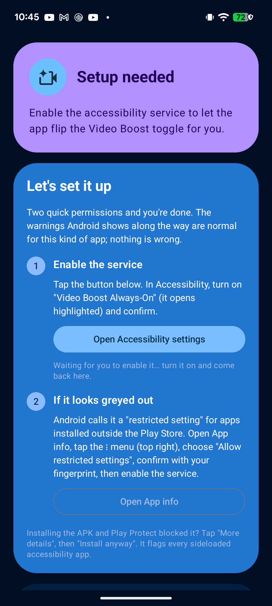
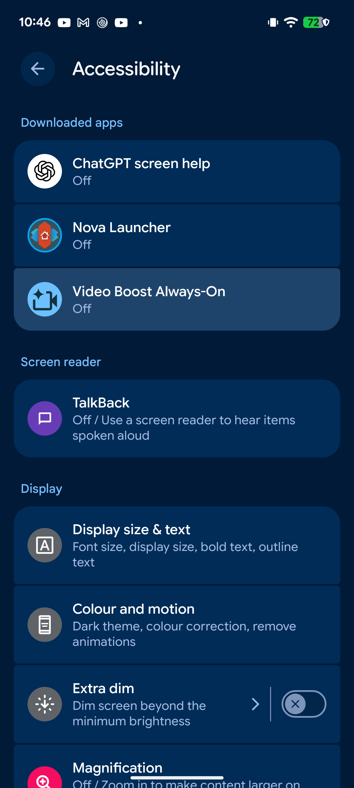
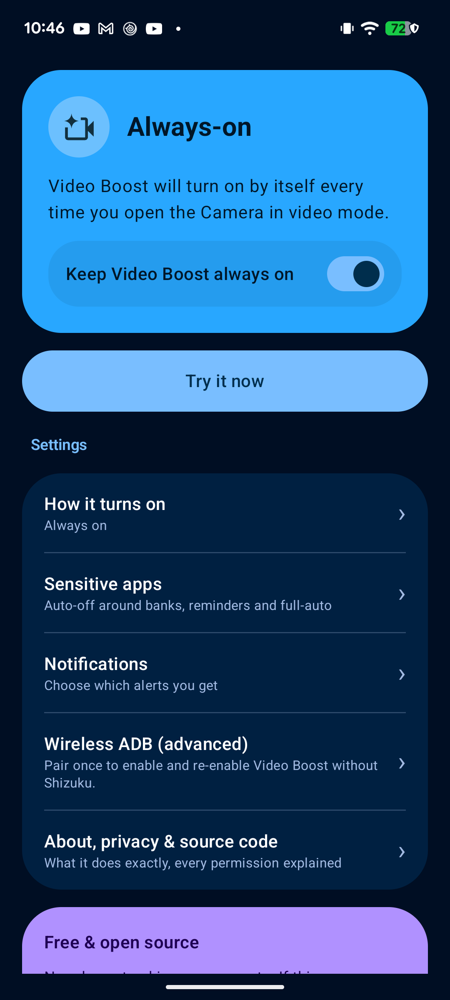
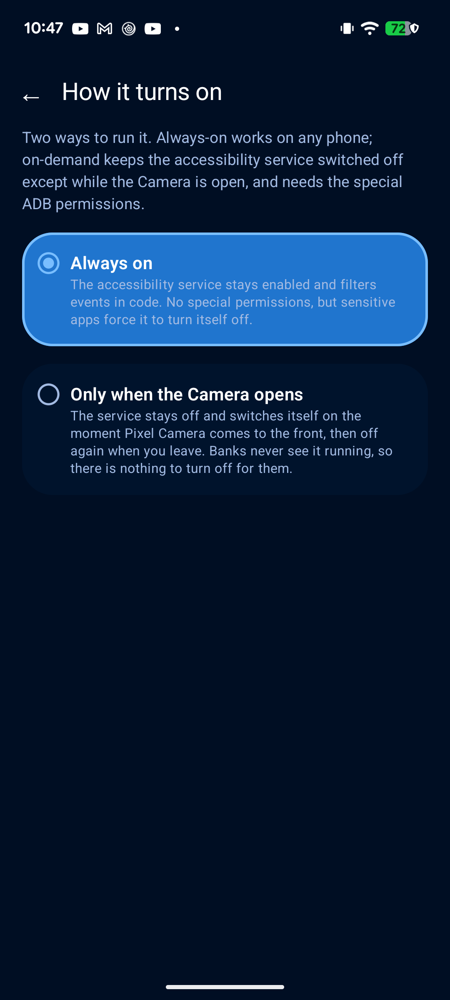
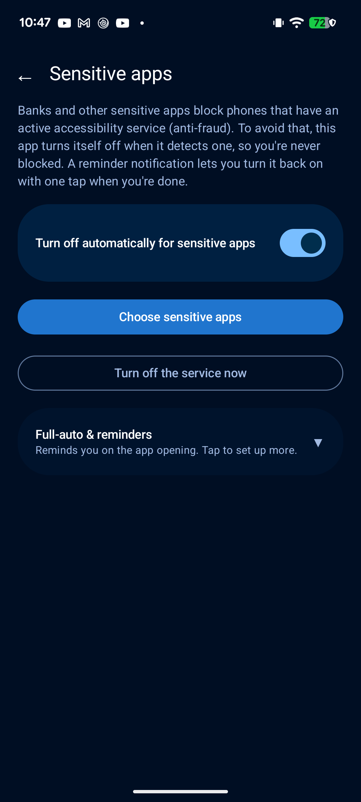
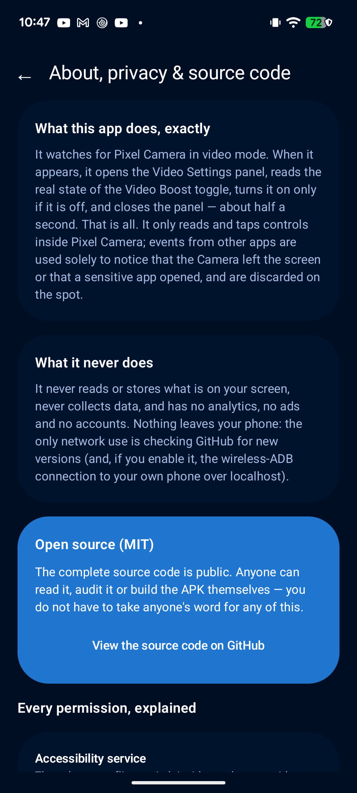
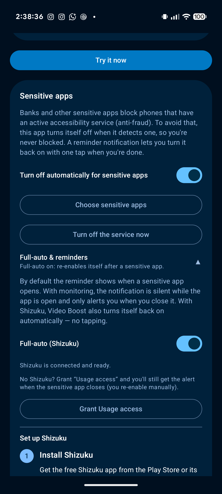

# Video Boost AO (Always-On)

[](https://github.com/AgusRomeroL/video-boost-ao/releases/latest)
[](LICENSE)
[](https://ko-fi.com/agusromero)

**Keep Video Boost always on for your Pixel Pro. No root.**

Pixel Camera deliberately turns Video Boost off every time you close the app
(Google briefly made it persistent in Feb 2025 and then reverted it). There is
no flag, intent or preference that can pin it without root, so this app
re-enables it for you, automatically, every time you open the camera in video
mode.

An `AccessibilityService` detects Pixel Camera in the foreground, opens the
**Video Settings** panel, reads the actual state of the **Video Boost** toggle
and turns it on only if it is off (it never taps blindly; if it is already on
it does nothing). Then it closes the panel to leave the viewfinder exactly as
it found it. The whole sequence takes about half a second.

**Fully open source (MIT), no ads, no analytics, no accounts.** Everything the
app does is documented below in
[Transparency](#transparency-what-it-does-and-what-it-never-does) and
[Permissions, explained](#permissions-explained), and inside the app itself
under **About, privacy & source code**, so nobody has to take anyone's word
for it.

## Install

New here, or sharing the app with someone? See the
**[visual install & setup tutorial](docs/TUTORIAL.md)**. It covers the two
normal warnings (Play Protect and "restricted setting") with screenshots, and
includes a short blurb you can forward to whoever you send the app to.

### Recommended: Obtainium (automatic updates)

1. Install [Obtainium](https://github.com/ImranR98/Obtainium/releases).
2. Add this app: **[one-tap link](https://apps.obtainium.imranr.dev/redirect?r=obtainium://add/https://github.com/AgusRomeroL/video-boost-ao)**
   (or in Obtainium: *Add App* → paste `https://github.com/AgusRomeroL/video-boost-ao`).
3. Obtainium installs the latest release and updates it automatically from now on.

### Manual

1. Download the APK from the [latest release](https://github.com/AgusRomeroL/video-boost-ao/releases/latest)
   and install it (allow "install unknown apps").

### "App blocked by Play Protect" when installing the APK

Google Play Protect warns about **any** sideloaded app that declares an
accessibility service (the same warning Tasker, MacroDroid, etc. get). It does
not mean the app is unsafe. To proceed:

- Tap the APK again; on the "App blocked" dialog choose **More details** →
  **Install anyway**.
- If that option isn't offered: Play Store → profile → **Play Protect** →
  settings (⚙️) → turn off **Scan apps with Play Protect**, install, then turn
  it back on.
- **Installing via Obtainium avoids most of this friction** (session-based
  install), which is why it's the recommended method above.

The warning eases over time with reputation and by being listed on trusted
sources; it can't be fully removed without Play Store distribution, which this
app avoids on purpose (see *Distribution notes*).

### Then, one-time setup (both methods)

2. Open *Video Boost AO* → the app guides you: tap **Open Accessibility
   settings** (your service entry comes up highlighted) and enable
   *Video Boost Always-On*.
3. If Android shows **"Restricted setting"** (normal for sideloaded apps on
   Android 13+): tap **Open App info** in the app → ⋮ menu (top right) →
   **"Allow restricted settings"** (confirm with fingerprint/PIN) → retry
   step 2.
4. Open Pixel Camera in video mode: within ~0.5 s Video Boost turns on by
   itself (sparkle icon at the top left of the viewfinder). The app also has a
   **Try it now** button.

The app includes a **master switch** to pause/resume the automation without
touching accessibility settings, and checks GitHub for **updates** on launch
(a card appears when a new version is available).

## Screenshots

| Guided setup | Accessibility, highlighted | Active |
|:---:|:---:|:---:|
|  |  |  |
| Before setup, the app shows **only** the guide, with nothing to get lost in. | "Open Accessibility settings" jumps straight to your entry, **highlighted**. | Status, master switch and a short settings list; everything else lives one tap deeper. |

| Activation modes | Sensitive apps | About & privacy |
|:---:|:---:|:---:|
|  |  |  |
| Always-on or only while the Camera is open. | Auto-off around banks, reminders, full-auto. | What it does exactly, every permission explained. |

Full walkthrough (install, both Android warnings, and every screen):
**[install & setup tutorial](docs/TUTORIAL.md)**.

## Enabling the accessibility service (step by step)

Android does not let apps grant themselves this permission; you enable it once,
by hand. The app guides you the whole way:

1. In the app, open the **Setup guide** card and tap **Open Accessibility
   settings**. Android's Accessibility screen opens with **Video Boost
   Always-On highlighted** (see the middle screenshot above).
2. Tap it, turn the switch **on**, and confirm.
3. **If you see "Restricted setting"** (Android 13+ shows this for any app
   installed outside the Play Store): go back to the app, tap **Open App info**,
   then the **⋮** menu (top right) → **Allow restricted settings** → confirm
   with your fingerprint/PIN. Now repeat step 1.
   - If the **⋮** menu is missing: open the app once, swipe it away from
     Recents, then long-press its icon → **App info**; the menu appears there.
4. Back in the app, the hero turns to **"Always-on"** and the master switch is
   enabled. You're done.

You can pause the feature anytime with the **master switch** inside the app;
no need to disable accessibility.

## Features

- Re-enables Video Boost on every camera session, the thing Pixel Camera
  refuses to remember.
- **Two activation modes**: always on (works on any Pixel Pro, no special
  permissions) or **only when the Camera opens**, which keeps the accessibility
  service switched off the rest of the time. See
  [Activation modes](#activation-modes).
- **Notification controls**: a switch per notice, a silence-everything master,
  and shortcuts to the Android channel settings.
- **74 languages**: the UI labels it looks for are not guessed; they are
  extracted directly from the real Pixel Camera APK
  ([`CameraLabels.kt`](app/src/main/java/com/agustin/videoboostao/CameraLabels.kt)).
- **RTL-aware**: in Arabic/Hebrew/Farsi/Urdu the on/off segmented buttons are
  mirrored; the service picks the correct one (verified against the live UI).
- Idempotent and safe: reads the toggle state before acting; never turns
  Video Boost off; gives up quietly after a few attempts if the UI changed.
- **Grace period for sensitive apps**: after you leave your banking app it waits
  a configurable 0–10 minutes (3 by default) before turning itself back on, so
  stepping out for five seconds and going back doesn't trip the bank's
  anti-fraud check. The countdown notification lets you wait longer or turn it
  on now, and opening the Camera turns it on immediately.
- Material 3 Expressive UI (Compose) with dynamic color and a layout built for
  first-time users: the main screen shows only status, the master switch and a
  short settings list; mode, sensitive apps, notifications, wireless ADB and
  the About screen each live one tap deeper. Before setup, the app shows only
  the guided steps.
- **About, privacy & source code screen** in the app: what it does exactly,
  what it never does, every permission explained, why it isn't on the Play
  Store, and a link to this repo, readable *before* you grant anything.
- No root and no analytics. Full-auto is optional and off by default; when you
  want it, you can use either Shizuku **or** a built-in wireless-ADB mode (no
  second app). `INTERNET` permission is used for the GitHub release check and,
  if you enable it, the local ADB connection to your own device.

## Transparency: what it does, and what it never does

Granting an accessibility service is a big ask: Android's own dialog says
"full control of your device", and it should make you pause. So here is the
complete, auditable answer, which the app also shows in **About, privacy &
source code**:

**What it does, exactly.** It watches for Pixel Camera in video mode. When it
appears, it opens the Video Settings panel, reads the real state of the Video
Boost toggle, turns it on only if it is off, and closes the panel, all in
about half a second. That is all. It only reads and taps controls inside Pixel Camera;
accessibility events from other apps are used solely to notice that the Camera
left the screen or that a sensitive app opened, and are discarded on the spot
([`VideoBoostService.kt`](app/src/main/java/com/agustin/videoboostao/VideoBoostService.kt)).

**What it never does.** It never reads or stores what is on your screen, never
collects data, and has no analytics, no ads and no accounts. Nothing leaves
your phone: the only network use is checking GitHub for new versions
([`UpdateChecker.kt`](app/src/main/java/com/agustin/videoboostao/UpdateChecker.kt),
plain `HttpURLConnection`, fails silently offline) and, only if you enable it,
the wireless-ADB connection **to your own phone over localhost**.

**Don't take our word for it.** The complete source is in this repository under
the MIT license; anyone can read it, audit it, or build the APK themselves with
`./gradlew assembleRelease`.

## Permissions, explained

Everything the app declares or can be granted, and why:

| Permission | Required? | What it is for |
|---|---|---|
| **Accessibility service** | Yes | The only way to flip a switch inside another app without root. Only touches Pixel Camera; see [Transparency](#transparency-what-it-does-and-what-it-never-does). |
| **`INTERNET`** | Yes | One thing only: asking GitHub whether there is a newer release. No other traffic, ever. |
| **Notifications** (`POST_NOTIFICATIONS`) | Yes | The reminders and confirmations you control in the Notifications screen; every optional one can be switched off. |
| **Foreground service** | Yes | What Android requires while the app waits for a sensitive app to close, or for the Camera to open in on-demand mode. Its notification is system-required and can be silenced. |
| **Usage access** | Optional | Only for full-auto / on-demand mode: lets the app see which app is in the foreground, locally, so it knows when the Camera opens or a sensitive app closes. Nothing is recorded. |
| **`WRITE_SECURE_SETTINGS`** | Optional | Granted only by you, through wireless ADB or Shizuku: lets the app switch its own accessibility service on and off, the same `settings` command you would type over ADB, nothing else. |

**About the Play Store.** Play's policy forbids using accessibility to automate
another app, which is this app's whole purpose, so it is not, and will not
be, on the Play Store. That is also why **Play Protect warns** when you install
the APK: it flags every sideloaded accessibility app (Tasker and MacroDroid
users know the drill), and it does not mean something is wrong. See the
[install section](#app-blocked-by-play-protect-when-installing-the-apk) for how
to get past the warning, and *Distribution notes* below.

## Activation modes

There are two ways to run it. You pick one in **How it turns on**, on the main
screen, and you can switch back and forth at any time.

### Always on (default)

The accessibility service stays enabled and filters events in code. It works on
any Pixel Pro with no special permissions, and it is the mode everything below
about **sensitive apps** exists for: banks refuse to run while an accessibility
service is active, so the app turns itself off for them and back on afterwards.

### Only when the Camera opens (needs the ADB permissions)

The accessibility service stays **off**. A small foreground watcher notices that
Pixel Camera came to the front, switches the service on for that session, and
switches it off again when you leave. A bank never sees it running, so there is
nothing to turn off and nothing to re-enable.

It needs the two special permissions the app can already grant itself once
through wireless ADB or Shizuku (see the full-auto sections below):

- **Usage access**: to know which app is in the foreground.
- **`WRITE_SECURE_SETTINGS`**: to switch its own accessibility service on and
  off locally, with no ADB connection open at runtime.

If either one is missing, the app says so and keeps running in always-on mode
until you grant them; it never silently does nothing.

How it detects the camera, since that part has to be both instant and cheap: the
system's `CameraManager` availability callback fires the moment **any** app
takes a camera (no polling), and the app then confirms with usage stats that the
foreground app really is Pixel Camera. Instagram or WhatsApp opening their own
camera switches nothing on. A slow backup poll runs only while the screen is on,
in case the callback does not arrive.

**Grace period on exit** (0–60 s, 15 by default): stepping out to the gallery
and coming back does not switch the service off and on again. A sensitive app in
the foreground cuts the grace short and switches off at once.

## Notification controls

**Notifications**, on the main screen, has a switch for every optional notice
(service turned off, sensitive app closed, Video Boost is back on) plus an
optional silent **"Video Boost activated"** confirmation, off by default, that
tells you the toggle really was flipped in the Camera.

There is also a **Silence everything** master switch, and a shortcut to each
notification channel in Android settings for sound and importance.

Notifications that belong to a running foreground service (paused for a
sensitive app, the re-enable countdown, the on-demand watcher) can be silenced
but not hidden: Android requires them while the service runs, and the app does
not pretend otherwise with a switch that would do nothing.

## Requirements

- A Pixel Pro model with Video Boost (Pixel 8 Pro and newer Pro models).
- Recent Pixel Camera (10.x line, Android 16).

## Heads-up: data & storage

Video Boost processes video in the cloud through Google Photos: each boosted
video is uploaded and stored twice, using data and storage. Always-on means
more of both.

## Troubleshooting

| Symptom | Cause / Fix |
|---|---|
| **"App blocked to protect your device" (Play Protect)** | Expected for any sideloaded accessibility app; not a defect. Tap **More details → Install anyway**, or temporarily disable Play Protect scanning. Obtainium avoids most of this. See the install section. |
| **Can't enable the service ("Restricted setting")** | Normal for sideloaded apps on Android 13+. App info → ⋮ → **Allow restricted settings** → confirm, then enable it (see steps above). Installing via a session-based installer (SAI, or Obtainium) avoids this. |
| **Service enabled, but Video Boost doesn't turn on** | Make sure the camera is in **Video** mode (Video Boost only exists there) and your device actually **has** Video Boost (Pixel Pro, 8 Pro+). Confirm the sparkle icon appears top-left. Check logs: `adb logcat -s VideoBoostAO`. |
| **It worked, then stopped after a Pixel Camera update** | A Feature Drop changed the UI. See *maintenance* below: re-anchor the resource-id and regenerate the localized labels. Open an issue and I'll push a fix. |
| **Nothing happens right after enabling** | Android sometimes needs a moment to bind a freshly enabled service. Close the camera fully and reopen it once. |
| **Boots but toggle looks off in my language** | The labels cover 74 languages extracted from the camera APK. If yours regressed after an update, open an issue with your system language. |
| **Turned it off by accident** | Use the master switch in the app, or if you disabled the accessibility service, just re-enable it; your settings are kept. |
| **Battery/data concern** | Video Boost uploads every video to Google Photos and keeps two copies. Pause with the master switch when you don't need it. |

Found a bug or a language/Feature-Drop regression? Please
[open an issue](https://github.com/AgusRomeroL/video-boost-ao/issues) with
your Pixel model, Android version, Pixel Camera version, and `adb logcat -s
VideoBoostAO` output if you can.

## Sensitive apps (banking, etc.)

> This section is about **always-on** mode. In **on-demand** mode the service
> only exists while the Camera is open, so none of this machinery is needed and
> the app hides it.

Banks and other sensitive apps refuse to run when any non-allowlisted
accessibility service is **enabled** (an anti-fraud measure, since that API can
read the screen). They can't tell that this app is harmless, so they show an
"uninstall this app" block.

To avoid it, the app **turns its own accessibility service off when it detects a
sensitive app in the foreground** (`disableSelf()`), so you're never blocked.

**By default** (no extra setup) it posts a **reminder notification** the moment
the app opens: tap it (once you're done) to turn Video Boost back on in one step.

The built-in list
([`SensitiveApps.kt`](app/src/main/java/com/agustin/videoboostao/SensitiveApps.kt))
covers ~330 apps: the major banks of every country where the Pixel is officially
sold, plus global fintech, crypto wallets, authenticators, and password managers.
Every package is verified against its Google Play listing. In the app you can:

- Toggle the auto-off behavior on/off.
- **Add your own apps** ("Choose sensitive apps") if something isn't covered.
- Turn the service off on demand.
- Enable **Full-auto** or **smart reminders** (below).

### Smarter reminders and full-auto

A disabled accessibility service is blind: on its own it can't tell when you
*leave* the sensitive app. Give the app a way to watch the foreground and it gets
much nicer:

| Setup | While the app is open | When you close it |
|---|---|---|
| **Default** (nothing) | reminder fires immediately | nothing (you re-enable manually) |
| **Usage access** granted | **silent** "paused" notice | **alerting** reminder to re-enable |
| **Shizuku** (full-auto) | **silent** "paused" notice | **re-enables itself** + a "back on" notice |
| **Wireless ADB** (full-auto, no extra app) | **silent** "paused" notice | **re-enables itself** + a "back on" notice |

So the notification is only *silent* while you're actually in the bank app, and
only *alerts* you once you're out, and with full-auto you don't even have to tap.

**The grace period.** With full-auto, turning the service back on the instant you
leave is a problem of its own: step out of your bank for five seconds to check
something, come back, and the bank now sees an active accessibility service and
blocks you. So the re-enable waits: **3 minutes by default, adjustable from 0 to
10** under *Sensitive apps → Wait before turning back on*. During the wait:

- Going back into any sensitive app **cancels** it and returns to the silent
  paused state.
- Opening **Pixel Camera** re-enables **immediately**, so the delay never costs
  you Video Boost.
- The countdown notification (the one that alerts) carries **"Wait +N min"** and
  **"Turn on now"**; when it finally re-enables, that same notification becomes
  "Video Boost is back on" without making a second sound.

- **Usage access** is a standard Android permission (Settings → Special access →
  Usage access). It only lets the app see which app is in the foreground; nothing
  leaves the device.
- **Shizuku** lets the app re-enable its own accessibility service without root,
  by running the same `settings` command ADB would. Setup below.
- **Wireless ADB** does the same thing without any second app: Video Boost pairs
  with your phone's own "Wireless debugging" and runs those `settings` commands
  itself. Setup below.

### Full-auto with Shizuku (optional)

[Shizuku](https://shizuku.rikka.app/) runs a small helper with shell (ADB-level)
privileges that ordinary apps can talk to, with no root required. Video Boost uses it
only to flip its own accessibility service back on after a sensitive app closes.

1. **Install Shizuku** from the Play Store or <https://shizuku.rikka.app/>.
2. **Start Shizuku.** Open it and start the service via **wireless debugging**
   (Android 11+), a **computer with ADB**, or **root**. Follow Shizuku's built-in
   instructions. Note it must be started again after each reboot (its own docs
   cover automating this).
3. In Video Boost open **Sensitive apps → Full-auto & reminders**, turn on
   **Full-auto (Shizuku)**, and **allow** the permission Shizuku prompts for.

<p align="center"></p>

That's it. From then on, opening a sensitive app pauses Video Boost silently and
closing it turns Video Boost back on automatically. If Shizuku ever isn't running,
the app quietly falls back to the reminder notification.

### Full-auto without Shizuku: wireless ADB (optional)

If you'd rather not install a second app, Video Boost can talk to your phone's
own **Wireless debugging** directly. It pairs once, over localhost, and from then
on it can turn its accessibility service on and re-enable it after a sensitive
app closes: the exact same `settings` commands, no root, no Shizuku.

Pairing works like Shizuku's: **you never leave the pairing screen**. Video
Boost watches for the pairing dialog over mDNS and, the moment it appears, sends
a notification with an inline reply where you type the code.

1. **Enable Wireless debugging.** Settings → System → Developer options →
   **Wireless debugging** (unlock Developer options first by tapping the build
   number 7 times).
2. **Start pairing.** In Video Boost open **"No Shizuku? Use wireless ADB"** and
   tap **Start pairing**.
3. **Open the pairing dialog.** In Wireless debugging, tap **"Pair device with a
   pairing code"**. A Video Boost notification pops up asking for the code. Type
   the 6-digit code into it **right there, without leaving the screen** (the IP
   and port are found automatically over mDNS). It pairs and turns full-auto on.
4. Use **Turn on Video Boost now** to enable the accessibility service the first
   time (skips the sideload "Restricted setting" wall).

> A manual entry (type the code, IP and port yourself) is also available under
> **"Enter the code here instead (advanced)"**, but on most phones leaving the
> pairing screen ends the session; the notification flow above avoids that.

**It only uses the connection once.** When you turn full-auto on, the app spends
that one connection granting itself two permissions: *Usage access* (so it can
see which app is in the foreground locally) and `WRITE_SECURE_SETTINGS` (so it
can re-enable its own accessibility service with a local write). Both are granted
with the same `pm`/`appops` commands you'd type over ADB. From then on a
sensitive-app session opens **no ADB connection at all**, which is also why
Android's own "Wireless debugging" notification stops reappearing every few
seconds while your bank is open.

`WRITE_SECURE_SETTINGS` is a `development`-level permission: it can't be granted
by tapping something in Settings, only by a shell (`pm grant`), and it only lets
the app write settings it was already writing over ADB. It is not revoked when
you turn full-auto off (revoking needs another ADB connection, and the permission
grants no access to your data); uninstalling the app removes it.

After a reboot you have to re-enable the "Wireless debugging" toggle once (an
Android limitation; Shizuku has the same one) and tap **Reconnect**, but only
if the local permission above isn't granted yet. Once it is, full-auto keeps
working after a reboot with wireless debugging switched off. No new pairing code
is ever needed, because the paired key is kept.

This mode is built on the open-source
[libadb-android](https://github.com/MuntashirAkon/libadb-android) (Apache-2.0),
which bundles [spake2-android](https://github.com/MuntashirAkon/spake2-java)
(**LGPL-3.0**) for the pairing handshake and BouncyCastle (MIT). Note that it is
a community library that has not been independently security-audited, and it
exercises the same shell-level privilege ADB has, so enable it only if you're
comfortable with that. Nothing leaves the device: the connection is to your own
phone over localhost.

## If it stops working (maintenance)

Pixel Camera Feature Drops can change texts, ids or view hierarchy.

- The panel-entry `resource-id` lives in
  [`Selectors.kt`](app/src/main/java/com/agustin/videoboostao/Selectors.kt);
  localized labels live in `CameraLabels.kt`.
- Re-anchor resource-ids with a live dump (camera in video mode, panel open):

  ```
  adb exec-out uiautomator dump /dev/tty
  ```

- Regenerate localized labels from the real camera APK with
  [`tools/gen-labels.ps1`](tools/gen-labels.ps1):

  ```
  adb shell pm path com.google.android.GoogleCamera   # locate base.apk
  adb pull <base.apk> tools/gcam-base.apk
  aapt2 dump resources tools/gcam-base.apk > tools/gcam-resources.txt
  powershell tools/gen-labels.ps1
  ```

  Relevant resources: `string/sapphire_label` (row label), `string/mode_video`
  (mode chip), `string/sapphire_on_desc` (on-button content description).
  "Sapphire" is Video Boost's internal codename.

Debug logs: `adb logcat -s VideoBoostAO`

## Build

Android SDK (platform 36) + JDK 17 (Android Studio's JBR works):

```
./gradlew assembleDebug     # debug build
./gradlew assembleRelease   # signed release (needs keystore.properties)
```

Release signing reads `keystore.properties` (repo root, gitignored) pointing
to a keystore **outside** the repo:

```properties
storeFile=PATH\\TO\\your-release.keystore
storePassword=...
keyAlias=...
keyPassword=...
```

## Distribution notes

**Not on Google Play, on purpose.** This app uses an `AccessibilityService`
for a non-accessibility purpose (automating another app's UI), which Play's
policy requires declaring and effectively prohibits, with account-level
enforcement risk. Distribution is via GitHub Releases (this repo), Obtainium,
and F-Droid-compatible repos that ship the developer-signed APK. The friction
this causes at install time (Play Protect, restricted settings) is covered in
[Permissions, explained](#permissions-explained) and the
[tutorial](docs/TUTORIAL.md).

## Support

The app is free, open source, and has no ads or tracking, and will stay that
way. If it saves you a daily tap, you can support development (it helps keep
the app working after every Pixel Camera Feature Drop):

[](https://ko-fi.com/agusromero)

## License

[MIT](LICENSE) © 2026 Agustín Romero López
