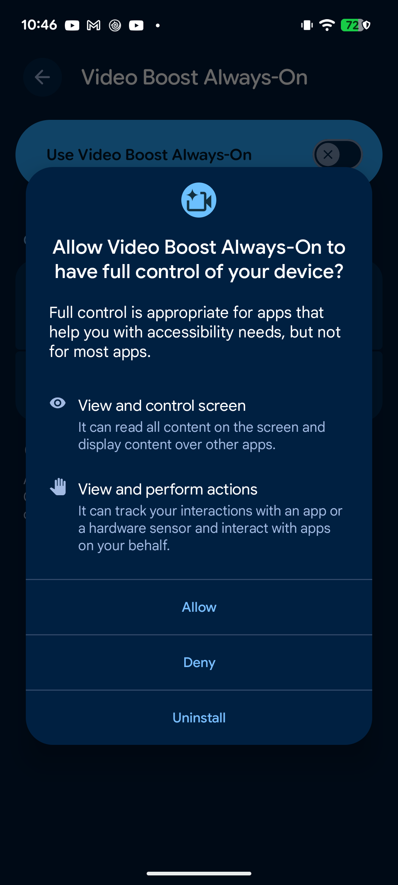
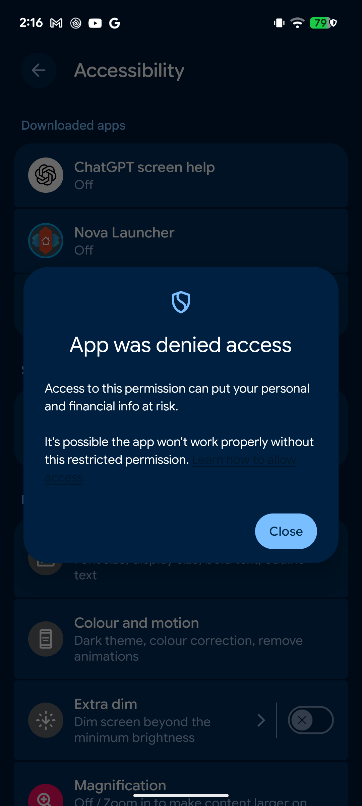
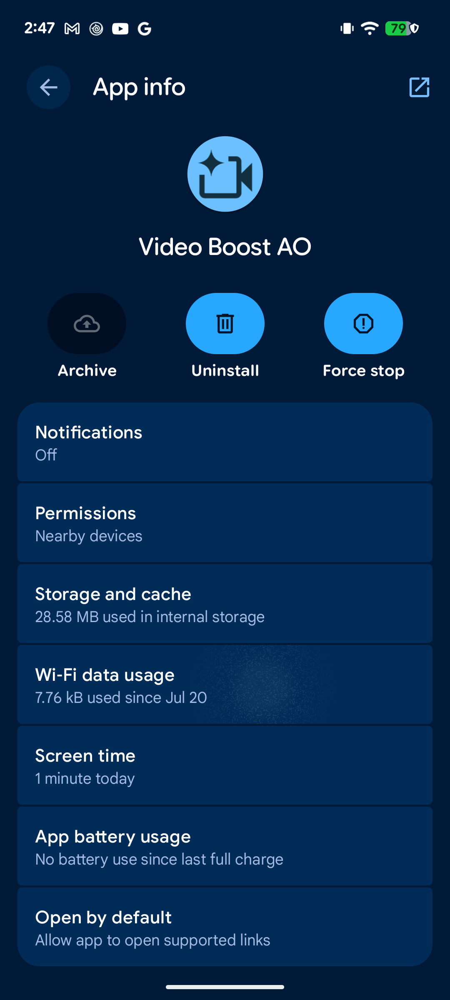
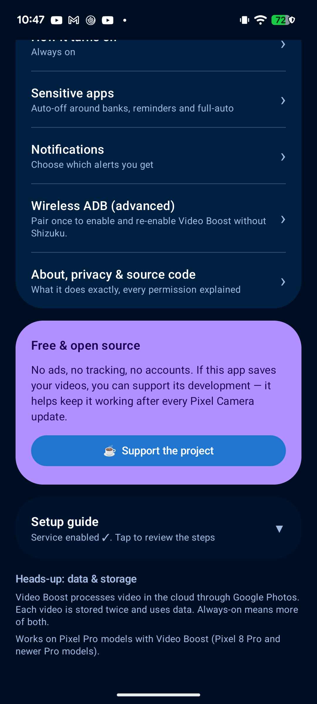
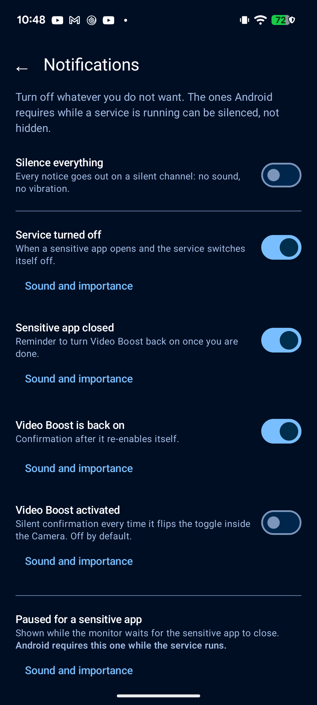
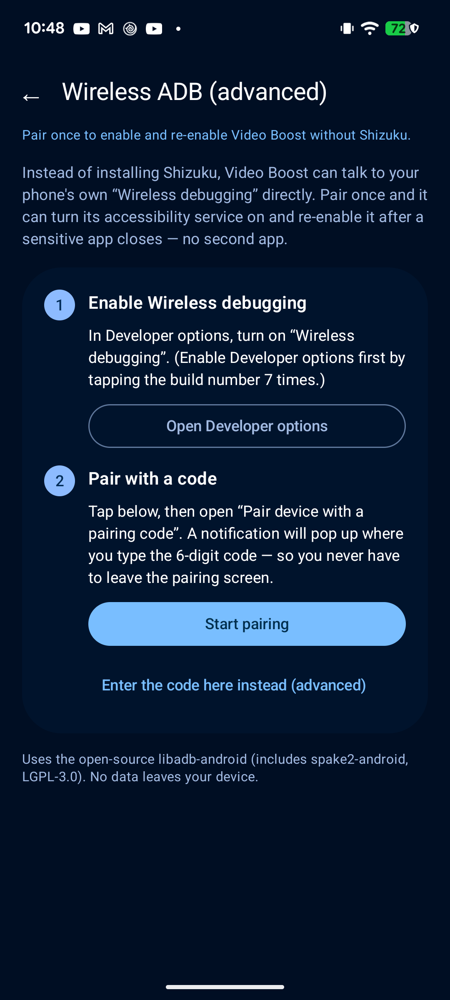
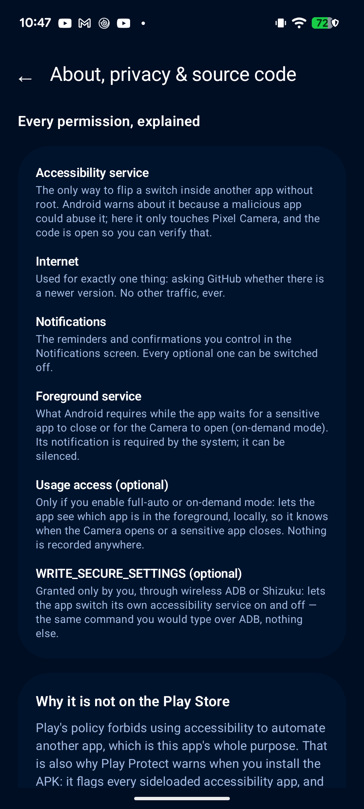

# Video Boost AO: install & setup tutorial

A visual walkthrough, from installing the APK to every screen in the app.
The basic setup takes about a minute.

## Forward this to anyone you share the app with

> **Video Boost AO** keeps Video Boost on automatically on your Pixel Pro, so
> you never have to flip it on before every video.
>
> When you install it, Android will show two scary-looking warnings. **Both are
> normal for this kind of app and don't mean anything is wrong**. They appear
> for *any* app installed outside the Play Store that automates the screen
> (Tasker, MacroDroid, etc. get the exact same ones):
>
> 1. **"App blocked by Play Protect"**: tap **More details, then Install anyway**.
> 2. **"Restricted setting"** when enabling the accessibility service: open the
>    app's **App info**, tap the **⋮** menu, choose **Allow restricted
>    settings**, confirm with your fingerprint, then enable the service.
>
> The app only reads and taps controls *inside Pixel Camera*. It has no ads, no
> analytics, and its only network use is checking GitHub for updates. It is
> fully **open source**: https://github.com/AgusRomeroL/video-boost-ao, and the
> app itself has an **"About, privacy & source code"** screen that explains
> exactly what it does and what every permission is for.
>
> Easiest install with automatic updates: add the repo to
> [Obtainium](https://github.com/ImranR98/Obtainium).

## Why the warnings appear

The whole point of the app is to flip a switch inside Pixel Camera for you. The
only way to do that without root is Android's **accessibility** API. Google
(correctly) treats that API as sensitive, because a malicious app could abuse it
to read the screen. So both Play Protect and the "restricted setting" gate exist
to make you *stop and confirm* before granting it. You are confirming that you
trust this specific app, which you can, because the code is open and it only
touches Pixel Camera. There is no way to remove these prompts without shipping on
the Play Store, which this app avoids on purpose (Play's policy forbids using
accessibility to automate another app's UI). More on that in the README's
[Transparency](../README.md#transparency-what-it-does-and-what-it-never-does)
and [Permissions](../README.md#permissions-explained) sections.

## Part 1: Install and enable

The app walks you through it. The setup guide stays available inside the app the
whole time, and until the service is enabled the main screen shows **only** the
setup, with no settings to get lost in.

### 1. Open the app

Fresh install shows a guided **"Let's set it up"** card with the two steps.

### 2. Tap "Open Accessibility settings"

The app jumps you straight to Accessibility with **Video Boost Always-On**
highlighted. Tap it and turn **Use Video Boost Always-On** on.

### 3. Android asks for confirmation

This is Android's standard dialog for **any** accessibility service, and its
wording is intentionally broad ("full control of your device"). What this app
actually does with the permission: read and tap controls inside Pixel Camera,
nothing else, and the in-app **About** screen and the open source code spell it
out. Tap **Allow**.

### 4. If the toggle is greyed out ("Restricted setting")

On APK installs Android often greys the entry out and shows this dialog. It's
the standard block for apps installed outside the Play Store, not a problem with
this app. Tap **Close**, then lift the restriction (next step).

### 5. Allow restricted settings

Back in the app tap **Open App info**. On the App info screen, tap the **⋮** menu
(top right) and choose **Allow restricted settings**, then confirm with your
fingerprint or PIN. Now repeat step 2 and the toggle will work.

### 6. Done

The hero turns to **Always-on**: Video Boost turns on by itself every time you
open the Camera in video mode. The switch inside the hero pauses the automation
whenever you want, without touching accessibility settings, and **Try it now**
opens the Camera so you can watch it work.

## Part 2: Getting to know the app

Once the service is enabled, the main screen shows a short settings list. Every
entry has a one-line summary of its current state, so you always know how the
app is configured without opening anything.

### How it turns on (activation modes)

Two ways to run it, both valid; this screen explains them and lets you switch
at any time:

- **Always on** (default): the accessibility service stays enabled. Works with
  no special permissions; sensitive apps make it turn itself off (next section).
- **Only when the Camera opens**: the service stays off and is switched on just
  for the camera session. Banks never see it. Needs the two special permissions
  the app can grant itself once through **Wireless ADB** or Shizuku, and the screen
  tells you exactly what is missing and grants it with one tap once ADB is
  paired.

### Sensitive apps (banking)

Banks block phones with an active accessibility service (anti-fraud). This
screen controls the protection: the app turns itself off automatically when a
flagged app opens (~330 banks/wallets built in, plus any you add), reminds you
with a notification and, with full-auto via Shizuku or wireless ADB, turns
itself back on when you leave, after a configurable grace period.

### Notifications

Every optional notice has its own switch, there is a **Silence everything**
master, and each row links to its Android channel for sound and importance. The
ones Android requires while a foreground service runs can be silenced, not
hidden, and the app says so instead of faking a switch.

### Wireless ADB (advanced)

The in-app alternative to Shizuku: pair once with your phone's own **Wireless
debugging** and the app can enable its accessibility service (skipping the
restricted-setting wall) and re-enable it automatically after a sensitive app.
The pairing happens through a notification, so you never leave the pairing
screen. Optional: the app works fine without it.

### About, privacy & source code

The transparency screen: what the app does exactly, what it never does, every
permission explained in plain language, why it isn't on the Play Store, and a
link to this repository. If you (or the person you shared the app with) feel
uneasy about the accessibility warning, this screen is the answer.

| | |
|:---:|:---:|
|  |  |

---

*Screens captured on a Pixel 7 (Android 16). The app works on Pixel Pro models
that actually have Video Boost: Pixel 8 Pro and newer Pro models.*
